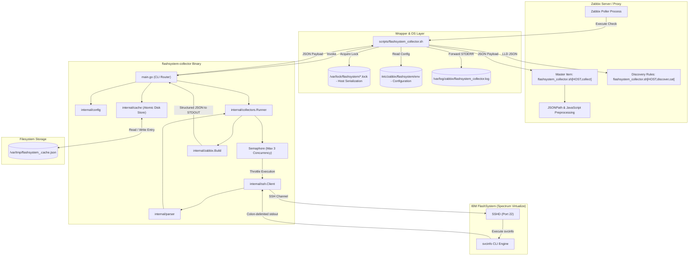
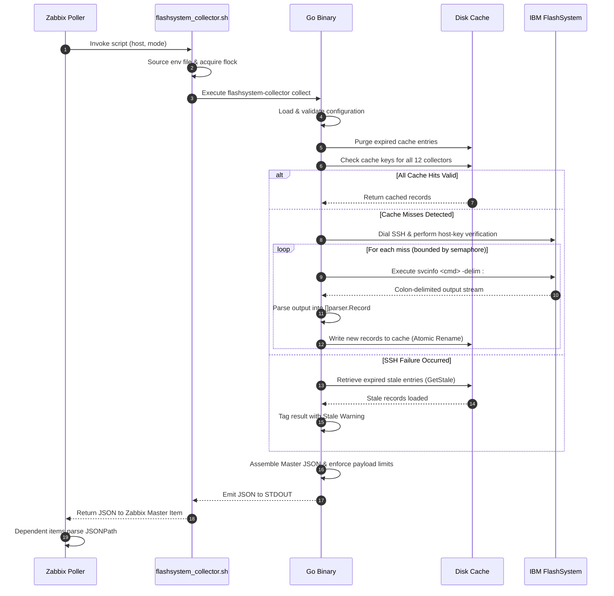

# Architecture 🏛️

The architecture of `flashsystem-collector` is built around principles of high efficiency, strict resource isolation, and operational resilience. This page details the high-level system components, internal Go package structure, data flow pipelines, and concurrency controls.

---

## High-Level System Architecture

The monitoring pipeline consists of three core functional layers:

1. **Ingestion & Orchestration Layer (Zabbix Server / Proxy)**: Zabbix pollers trigger external checks, parse JSON payloads via JSONPath, and maintain trend and history databases.
2. **Execution & Mediation Layer (Host Filesystem & Collector)**: A Bash wrapper handles serialization locks, while the Go binary loads configuration, checks cache, coordinates SSH interactions, and outputs normalized JSON.
3. **Target Layer (IBM FlashSystem / Spectrum Virtualize)**: The storage cluster's embedded SSH daemon executes read-only CLI commands against the virtualization microcode.



---

## Component Responsibilities

The codebase is organized into cleanly separated, modular Go packages under `internal/`:

| Package / Component | Primary Responsibility |
| :--- | :--- |
| **`main.go`** | CLI entrypoint, command-line routing (`collect`, `discover`, `version`), high-level execution orchestration, and fallback handling. |
| **`internal/config`** | Parses command-line flags and environment variables, enforces hierarchy precedence, validates file paths, directory write access, and verifies private key permissions. |
| **`internal/ssh`** | Establishes authenticated SSH connections, parses OpenSSH private keys, handles TCP dial timeouts, command execution timeouts, and performs cryptographic host key validation. |
| **`internal/parser`** | Parses raw IBM colon-delimited (`-delim :`) output into structured slices of key-value maps (`[]parser.Record`), handling multiline key-value pairs and tabular matrices. |
| **`internal/cache`** | Manages thread-safe, disk-backed JSON cache storage, enforcing TTL policies, atomic file renames, startup purges, and retrieval of expired stale records. |
| **`internal/collectors`** | Defines the `Collector` interface, implements all 12 individual domain collectors, and provides the concurrent `Runner` bounded by worker semaphores. |
| **`internal/zabbix`** | Constructs the final output envelope (`Output`), aggregates collector runs, applies volume and drive truncation limits, and formats LLD discovery envelopes. |
| **`scripts/flashsystem_collector.sh`** | External script wrapper providing environment bootstrapping, non-blocking `flock` serialization per host, log rotation, and crash-safe exit wrapping. |

---

## Data Flow Pipeline

The end-to-end data pipeline follows a strict multi-stage transformation:



---

## Concurrency and Resource Management

### SSH Throttling via Internal Semaphore
Executing 12 storage queries simultaneously over SSH can overwhelm storage processor management queues. `flashsystem-collector` implements an internal token bucket / semaphore pattern within `internal/collectors/collector.go`:

```go
// Semaphore channel limiting concurrent SSH command executions
sem := make(chan struct{}, r.cfg.MaxConcurrent) // Default: 3 concurrent slots
```

- When `RunAll` launches goroutines for each collector, each goroutine must acquire an empty slot in `sem` before executing an SSH command.
- As soon as the command completes and the output is parsed, the slot is released for the next collector.
- This ensures that at any given instant, no more than 3 active SSH commands are executing concurrently against the IBM FlashSystem controller.

### Host-Level Serialization via `flock`
While the Go binary controls internal concurrency, multiple Zabbix poller threads might attempt to query the same storage system simultaneously. To eliminate race conditions and avoid duplicate SSH sessions, `scripts/flashsystem_collector.sh` uses Linux file descriptor locking:

- Lock directory: `/var/lock/flashsystem/`
- Host lock file: `flashsystem_<host>.lock`
- Acquired via: `exec 200>"${lock_file}"; flock -w 55 200`
- If an instance is already running for `<host>`, subsequent invocations will wait up to 55 seconds for the lock to become available rather than spawning parallel processes.
