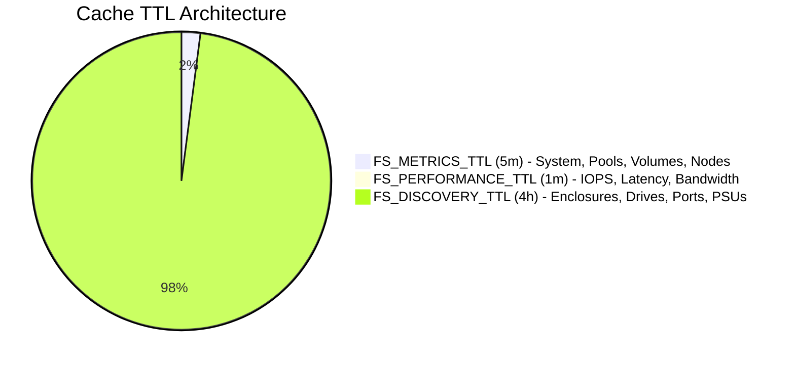

# Cache and Resilience 🛡️

The caching engine implemented in `internal/cache/cache.go` is the core reliability layer of `flashsystem-collector`. It balances low-overhead storage monitoring against array controller safety and network disruption resilience.

---

## 1. Multi-Tier Cache Architecture

Rather than assigning a single static cache expiration across all storage metrics, the collector establishes three distinct Time-to-Live (TTL) tiers:



1. **Performance Telemetry (`FS_PERFORMANCE_TTL`, default `1m`)**: Real-time I/O statistics (`lssystemstats`) change continuously and must be refreshed every 60 seconds to provide accurate latency and bandwidth visibility.
2. **Operational Inventory (`FS_METRICS_TTL`, default `5m`)**: Cluster capacity, pool allocation, and volume counts change gradually throughout the day. A 5-minute window protects the storage array from frequent query load while maintaining up-to-date capacity forecasting.
3. **Hardware Discovery (`FS_DISCOVERY_TTL`, default `4h`)**: Physical drive slots, enclosures, batteries, power supplies, and WWPNs rarely change in production SAN environments. A 4-hour discovery window drastically cuts SSH session volume without compromising hardware fault detection.

---

## 2. Atomic Cache Writes

In high-frequency monitoring environments, sudden process kills (e.g., Zabbix poller timeout signals) can corrupt files if data is written directly to disk.

`flashsystem-collector` guarantees file integrity using **atomic filesystem operations**:

```go
// Atomic write sequence in internal/cache/cache.go
tmpPath := filepath.Join(c.dir, fmt.Sprintf(".flashsystem_cache_%d_%s.tmp", os.Getpid(), safeKey))
if err := os.WriteFile(tmpPath, data, 0640); err != nil {
    return err
}
return os.Rename(tmpPath, c.filePath)
```

1. Data is written to an ephemeral temporary file (`.flashsystem_cache_<pid>_<key>.tmp`).
2. The operating system flushes bytes to disk.
3. The temporary file is committed via POSIX `os.Rename`. On Linux filesystems, `rename(2)` is an atomic pointer swap, guaranteeing that the primary cache file is never partially written or corrupted.

---

## 3. Stale-Data Fallback Mechanics

When an enterprise storage system undergoes maintenance, a controller reboot, or transient network partition, normal monitoring scripts fail and return empty strings. In Zabbix, this causes:
- Capacity charts to plummet to 0 Bytes.
- IOPS graphs to drop to 0.
- Trigger flap storms (e.g., hundreds of alerts asserting "Volume not found").

`flashsystem-collector` eliminates this problem through **Stale-Cache Fallback**:

```mermaid
sequenceDiagram
    participant Z as Zabbix Poller
    participant C as flashsystem-collector
    participant S as IBM FlashSystem CLI
    participant D as Disk Cache (Expired Entries)

    Z->>C: Execute collect (every 1m)
    C->>S: SSH Handshake & Connect
    Note over S: Controller in reboot / network timeout
    S--xC: Dial Timeout / Connection Refused
    Note over C: Trigger Stale Fallback Logic
    C->>D: Invoke c.GetStale(host)
    D-->>C: Return last known records (even if expired)
    C->>C: Set CacheHit=true
    C->>C: Populate Error="SSH failed (stale cache from <timestamp>): <err>"
    C-->>Z: Emit Valid JSON Payload + Error Warning
    Note over Z: Zabbix maintains history graph continuity; alerts on connection error
```

### Stale Warning Annotation
When serving stale data, the collector clearly marks the payload in `status.collector_runs`:
```json
{
  "name": "system",
  "record_count": 1,
  "cache_hit": true,
  "error": "SSH failed (stale cache from 2026-03-17T11:55:00Z): dial tcp 10.10.10.50:22: i/o timeout"
}
```
This allows Zabbix administrators to fire a single alert ("Storage management interface unreachable") while keeping all existing metric items and thresholds intact.

---

## 4. Automatic Startup Purge

To prevent cache files from growing indefinitely with stale or decommissioned host records, the collector invokes `cache.Purge()` at the beginning of every collection run:

- Iterates over all cached entries in memory.
- Identifies entries whose `CachedAt + TTL` is in the past.
- Removes obsolete records from the disk store.
