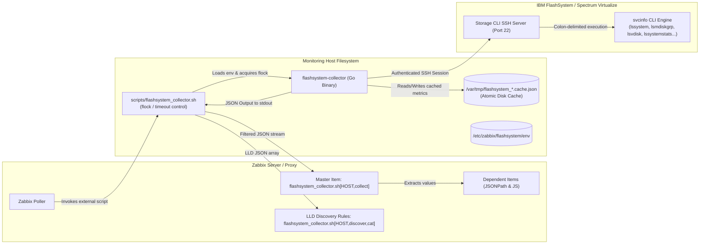

# thunderfinder/flashsystem-collector Wiki 📚

Welcome to the official technical documentation and systems architecture wiki for **`thunderfinder/flashsystem-collector`**.

This project provides an enterprise-grade, high-performance Go collector and Zabbix external integration engine designed for automated monitoring, capacity planning, and Low-Level Discovery (LLD) across **IBM FlashSystem** and **IBM Spectrum Virtualize** storage systems (including FlashSystem 5000, 5200, 7200, 7300, 9100, 9200, 9500, and legacy Storwize platforms).

---

## What the Project Does

`flashsystem-collector` solves the challenge of safely and efficiently collecting health, telemetry, and capacity statistics from IBM SAN Volume Controller (SVC) command-line interfaces without overwhelming the storage controllers:

- **Single-Pass Collection (Master Item Pattern)**: Queries physical status, performance counters, capacity metrics, and hardware state across 12 collector domains concurrently in a single operation, returning a unified JSON payload to Zabbix.
- **Dynamic Low-Level Discovery (LLD)**: Exposes native Zabbix discovery endpoints for pools, volumes, physical drives, canisters/nodes, enclosures, Fibre Channel ports, backup batteries, and power supply units (PSUs).
- **Resilient Multi-Tier Caching**: Persists operational metrics, performance statistics, and discovery trees with atomic writes and configurable Time-To-Live (TTL) values. In the event of storage network partitions or transient SSH handshake timeouts, it serves stale cache data tagged with diagnostic warnings, preventing monitoring graphs from dropping to zero and alerting engines from triggering false storm alarms.
- **Hardened Host Key & Keyfile Security**: Enforces strict POSIX file permissions (`0600`) on private keys and mandates cryptographic SSH host key verification via `known_hosts` files by default to guard against Machine-in-the-Middle (MITM) attacks.



---

## Quick Navigation

Explore the comprehensive documentation through the following topics:

### 1. Architectural Foundation & Core Concepts
- [[Introduction]]: Operational background, core design principles, scope, and non-goals.
- [[Features]]: Complete matrix of implemented features, collector capabilities, discovery endpoints, and limits.
- [[Architecture]]: High-level engine architecture, Go package layout, and data pipelines.
- [[How-It-Works]]: Step-by-step execution lifecycle, CLI parsing, SSH session handling, and JSON serialization.
- [[Requirements-and-Compatibility]]: Supported operating systems, Go toolchain requirements (Go 1.25.0), Zabbix version matrix, and IBM storage family compatibility.

### 2. Setup, Deployment & Integration
- [[Installation]]: Step-by-step binary compilation (`CGO_ENABLED=0`), package placement, script configuration, and directory permissions.
- [[Configuration]]: Full configuration reference table covering CLI flags, `FS_*` environment variables, default values, and precedence order.
- [[SSH-and-Security]]: SSH key generation, user privileges (`Monitor` role), host key validation with `FS_KNOWN_HOSTS`, and security hardening.
- [[Zabbix-Integration]]: Production template deployment (`template/IBM FlashSystem Collector.yaml`), user macros, Master/Dependent item architecture, and preprocessing rules.
- [[Monitoring-Metrics]]: Exhaustive reference catalog detailing all 84+ monitored items, Zabbix keys, units, collection frequencies, and diagnostic meanings.
- [[Low-Level-Discovery]]: JSON data schemas, macro mapping definitions, and discovery behavior across all 8 supported categories.

### 3. Reliability, Maintenance & Operations
- [[Cache-and-Resilience]]: Deep dive into multi-tier caching, TTL invalidation, atomic file write semantics, and stale-data fallback mechanics.
- [[Operations-and-Maintenance]]: Standard operational procedures, running manual collections, checking wrapper logs, log rotation, and maintenance workflows.
- [[Troubleshooting]]: Actionable guide to diagnosing SSH failures, host key mismatches, `lssystemstats` performance issues, timeouts, and JSON truncations.
- [[Performance-and-Scaling]]: Storage controller load impact, SSH concurrency throttling via internal semaphores, tuning timeouts, and large-environment deployment strategies.

### 4. Engineering, Testing & Governance
- [[Development]]: Go developer setup, coding conventions, collector interfaces, parser contracts, and extending CLI commands.
- [[Testing-and-Quality]]: Executing tests (`go test -race ./...`), parser unit tests, mock SSH assertions, and GitHub Actions CI pipelines.
- [[Release-and-Upgrade]]: Semantic versioning, compiling release binaries, upgrading wrapper scripts, updating templates, and rollback procedures.
- [[Limitations-and-Roadmap]]: Documented limitations, planned features, and technical debt tracking.
- [[Contributing]]: Contribution guidelines, pull request checklist, review standards, and agent persona interactions.
- [[FAQ]]: Frequently asked technical questions regarding authentication, storage performance, and integration edge cases.
- [[Glossary]]: Domain glossary spanning IBM Spectrum Virtualize concepts, Zabbix entities, and collector terminology.
- [[References]]: Official IBM Redbooks, IBM SVC CLI manuals, RFC standards, and Zabbix documentation links.

---

## Quick-Start Guide (5-Minute Deployment)

### 1. Build the Static Go Binary
Ensure Go 1.25.0+ is installed on your build machine:
```bash
git clone https://github.com/thunderfinder/flashsystem-collector.git
cd flashsystem-collector
CGO_ENABLED=0 GOOS=linux GOARCH=amd64 go build -trimpath -ldflags="-s -w" -o flashsystem-collector .
sudo install -m 0755 flashsystem-collector /usr/local/bin/flashsystem-collector
```

### 2. Install Wrapper Script & Setup Directories
On your Zabbix Server or Zabbix Proxy:
```bash
sudo install -d -m 0750 -o zabbix -g zabbix /etc/zabbix/flashsystem
sudo install -d -m 0700 -o zabbix -g zabbix /etc/zabbix/ssh
sudo install -d -m 0755 -o zabbix -g zabbix /var/lock/flashsystem
sudo install -m 0755 scripts/flashsystem_collector.sh /usr/lib/zabbix/externalscripts/flashsystem_collector.sh
```

### 3. Configure SSH Keys and Verification
Generate a dedicated SSH keypair and register the public key on the IBM FlashSystem with the `Monitor` user role:
```bash
sudo -u zabbix ssh-keygen -t ed25519 -f /etc/zabbix/ssh/flashsystem_key -N ""
chmod 0600 /etc/zabbix/ssh/flashsystem_key

# Populate known_hosts to prevent MITM attacks:
sudo -u zabbix ssh-keyscan -p 22 <FLASHYSTEM_IP> > /etc/zabbix/ssh/known_hosts
chmod 0644 /etc/zabbix/ssh/known_hosts
```

### 4. Create the Environment Configuration
Create `/etc/zabbix/flashsystem/env`:
```bash
sudo tee /etc/zabbix/flashsystem/env > /dev/null << 'EOF'
FS_USER=zabbix_monitor
FS_KEYFILE=/etc/zabbix/ssh/flashsystem_key
FS_KNOWN_HOSTS=/etc/zabbix/ssh/known_hosts
FS_CACHE_DIR=/var/tmp
FS_METRICS_TTL=5m
FS_DISCOVERY_TTL=4h
FS_PERFORMANCE_TTL=1m
EOF

sudo chown zabbix:zabbix /etc/zabbix/flashsystem/env
sudo chmod 0640 /etc/zabbix/flashsystem/env
```

### 5. Validate Execution
Run a test collection directly as the `zabbix` system user:
```bash
sudo -u zabbix /usr/lib/zabbix/externalscripts/flashsystem_collector.sh <FLASHSYSTEM_IP> collect
```
You should receive a structured JSON object containing physical hardware metrics, storage pool usage, and system statuses.

### 6. Import Zabbix Template
1. In the Zabbix Web UI, navigate to **Data collection** > **Templates** > **Import**.
2. Select `template/IBM FlashSystem Collector.yaml` and click **Import**.
3. Create a Host for your FlashSystem with interface set to `<FLASHSYSTEM_IP>`.
4. Link the `IBM FlashSystem Collector` template to the host.
5. In Host Macros, customize `{$FS_USER}`, `{$FS_KEYFILE}`, and capacity alert thresholds as required.
