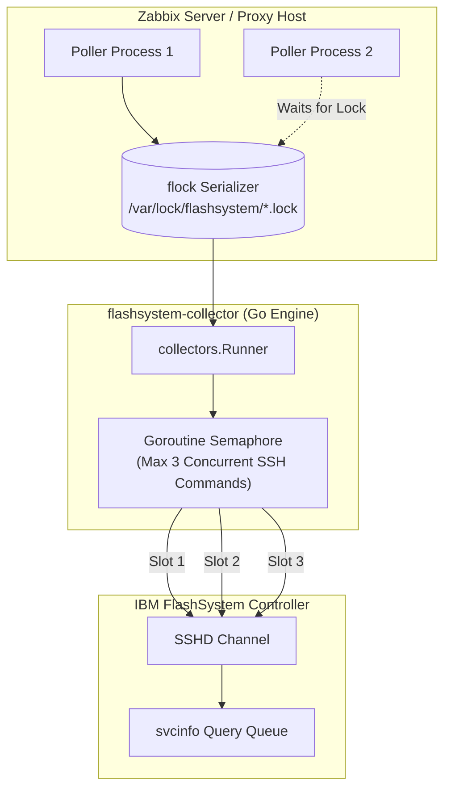

# Performance and Scaling ⚡

This guide examines the resource footprint, concurrency boundaries, storage controller load impacts, and tuning strategies when scaling `flashsystem-collector` across large enterprise SAN deployments.

---

## 1. Concurrency Model and Throttling

A primary design requirement for `flashsystem-collector` was ensuring that monitoring queries never degrade the I/O processing performance of the storage controller itself.



### 1. Internal Semaphore Throttling
- The Go engine processes 12 collector domains simultaneously using goroutines.
- To prevent opening 12 simultaneous SSH channels against the storage array, the runner uses a token-bucket semaphore (`MaxConcurrent = 3`).
- Only 3 commands execute in parallel on the storage controller at any moment. As each command completes, the next queued collector acquires the slot.

### 2. External Host Serialization (`flock`)
- In large Zabbix installations with numerous poller processes, multiple pollers might attempt to check the same FlashSystem simultaneously.
- The wrapper script uses `flock -w 55` on `/var/lock/flashsystem/flashsystem_<host>.lock`.
- If an instance is already running for a storage array, additional calls wait up to 55 seconds for the lock rather than spawning redundant SSH connections.

---

## 3. Storage Controller Load Considerations

The collector executes informational `svcinfo` commands that query storage metadata in RAM.

| Command | Storage CPU Impact | Execution Frequency Recommendation |
| :--- | :--- | :--- |
| `svcinfo lssystemstats` | Extremely Low (Reads RAM counters) | Every `1m` (matches `FS_PERFORMANCE_TTL`) |
| `svcinfo lssystem` | Very Low (Static metadata) | Every `5m` (matches `FS_METRICS_TTL`) |
| `svcinfo lsmdiskgrp` | Low (Pool metadata) | Every `5m` (matches `FS_METRICS_TTL`) |
| `svcinfo lsnode` | Very Low (Canister states) | Every `5m` (matches `FS_METRICS_TTL`) |
| `svcinfo lsenclosure` | Very Low (Shelf status) | Every `4h` (matches `FS_DISCOVERY_TTL`) |
| `svcinfo lsdrive` | Moderate on large arrays (>1000 drives) | Every `4h` (matches `FS_DISCOVERY_TTL`) |
| `svcinfo lsvdisk` | Moderate on large clusters (>5000 volumes) | Every `5m` (matches `FS_METRICS_TTL`) |

---

## 4. Scaling Across Multiple FlashSystems

When monitoring dozens of FlashSystem clusters from a single Zabbix Server or Proxy:

1. **Distribute Polling via Zabbix Proxies**:
   - For environments with $>20$ FlashSystem arrays, deploy dedicated Zabbix Proxies closer to the storage management network to offload external script execution from the central Zabbix Server.
2. **Increase External Script Pollers**:
   - In `/etc/zabbix/zabbix_server.conf` (or `zabbix_proxy.conf`), ensure sufficient external script worker processes:
     ```ini
     StartPollers=30
     StartPollersUnreachable=10
     Timeout=30
     ```
3. **Dedicated Cache Filesystem**:
   - Ensure the cache directory (`FS_CACHE_DIR`, default `/var/tmp`) has sufficient free inodes and write performance. Each monitored array consumes $\approx 50\text{KB}$ to $500\text{KB}$ of disk cache.
