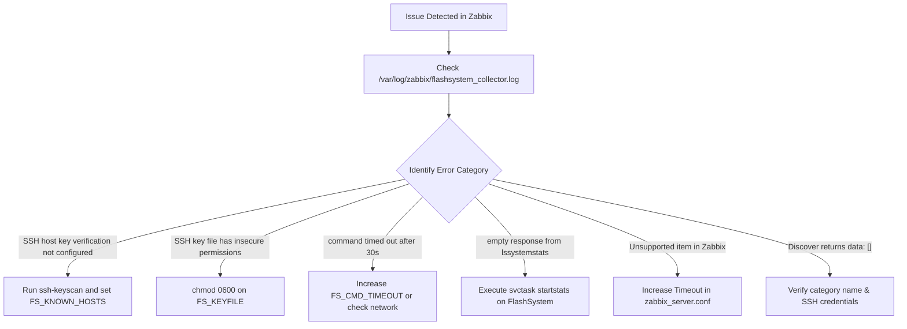

# Troubleshooting 🛠️

This guide provides structured diagnostic commands, root-cause analyses, and resolution procedures for common operational issues encountered with `flashsystem-collector`.

---

## 1. Quick Diagnostic Flowchart



---

## 2. Common Symptoms, Causes, and Solutions

### Symptom 1: `SSH host key verification not configured`
- **Probable Cause**: Neither `FS_KNOWN_HOSTS` nor `FS_INSECURE` is set in `/etc/zabbix/flashsystem/env`.
- **Diagnostic Command**:
  ```bash
  grep -E 'FS_KNOWN_HOSTS|FS_INSECURE' /etc/zabbix/flashsystem/env
  ```
- **Resolution**:
  Populate the `known_hosts` file and update configuration:
  ```bash
  sudo -u zabbix ssh-keyscan -p 22 <FLASHSYSTEM_IP> > /etc/zabbix/ssh/known_hosts
  sudo chmod 0644 /etc/zabbix/ssh/known_hosts
  echo "FS_KNOWN_HOSTS=/etc/zabbix/ssh/known_hosts" >> /etc/zabbix/flashsystem/env
  ```
- **Verification**:
  Rerun the collector manually; the error should disappear.

---

### Symptom 2: `SSH key file ... has insecure permissions (0644)`
- **Probable Cause**: The private key specified in `FS_KEYFILE` is accessible by group or others, violating security validation.
- **Diagnostic Command**:
  ```bash
  ls -l $(grep FS_KEYFILE /etc/zabbix/flashsystem/env | cut -d= -f2)
  ```
- **Resolution**:
  Enforce strict owner-only read/write permissions:
  ```bash
  sudo chmod 0600 /etc/zabbix/ssh/flashsystem_key
  sudo chown zabbix:zabbix /etc/zabbix/ssh/flashsystem_key
  ```

---

### Symptom 3: `empty response from lssystemstats`
- **Probable Cause**: Background statistics collection is disabled on the IBM FlashSystem cluster. Performance counters (`read_io`, `write_io`, `cpu_pc`, etc.) return blank.
- **Diagnostic Command**:
  Query the cluster statistics status directly:
  ```bash
  ssh -i /etc/zabbix/ssh/flashsystem_key zabbix_monitor@<FLASHSYSTEM_IP> "svcinfo lssystem -delim :" \
      | grep statistics_status
  # If output is: statistics_status:off
  ```
- **Resolution**:
  Enable statistics collection on the FlashSystem CLI (requires Administrator role):
  ```bash
  svctask startstats -interval 1
  ```
  *(Note: Interval `1` indicates 1-minute aggregation granularity).*
- **Verification**:
  Wait 60 seconds and run `flashsystem-collector collect`. The `performance` section should now contain non-empty metric arrays.

---

### Symptom 4: Zabbix Item Status is `Unsupported` (Script Timeout)
- **Probable Cause**: Zabbix server or proxy poller killed the external script because execution took longer than the default 3-second or 4-second poller timeout.
- **Diagnostic Command**:
  Inspect `/var/log/zabbix/zabbix_server.log`:
  ```bash
  grep -i "timeout while executing a shell script" /var/log/zabbix/zabbix_server.log
  ```
- **Resolution**:
  1. Open `/etc/zabbix/zabbix_server.conf` (or `zabbix_proxy.conf`).
  2. Increase the global execution timeout:
     ```ini
     Timeout=30
     # Or Timeout=55 in Zabbix 7.0+
     ```
  3. Restart Zabbix server/proxy:
     ```bash
     sudo systemctl restart zabbix-server
     ```
  4. In the host template, verify user macro `{$FS_TIMEOUT}` is set to `55s`.

---

### Symptom 5: Discovery Returns `{"data":[]}`
- **Probable Cause**:
  1. Invalid category argument specified.
  2. The storage cluster has no items of that type configured (e.g., no FlashCopy mappings).
  3. SSH connection failure occurred during discovery and no cached data was available.
- **Diagnostic Command**:
  Run discovery directly with `-verbose` enabled:
  ```bash
  sudo -u zabbix FS_VERBOSE=true /usr/lib/zabbix/externalscripts/flashsystem_collector.sh \
      <FLASHSYSTEM_IP> discover <CATEGORY>
  ```
- **Resolution**:
  Verify the category is one of the 8 supported categories:
  `drives`, `pools`, `volumes`, `enclosures`, `nodes`, `ports`, `batteries`, `psus`. Check stderr output for authentication or network issues.

---

### Symptom 6: Output Truncation Warning (`status.truncated_at`)
- **Probable Cause**: The storage array contains more volumes or drives than permitted by `-max-volumes` or `-max-drives`, or total payload size exceeded `-max-json-bytes`.
- **Diagnostic Command**:
  Check for truncation markers in output JSON:
  ```bash
  sudo -u zabbix /usr/lib/zabbix/externalscripts/flashsystem_collector.sh <FLASHSYSTEM_IP> collect \
      | grep -o '"truncated_at":{[^}]*}'
  ```
- **Resolution**:
  If your Zabbix server can handle larger JSON objects (Zabbix 6.4+ handles up to 16MB), increase the limits in `/etc/zabbix/flashsystem/env`:
  ```bash
  FS_MAX_VOLUMES=2000
  FS_MAX_DRIVES=1000
  FS_MAX_JSON_BYTES=2097152
  ```
