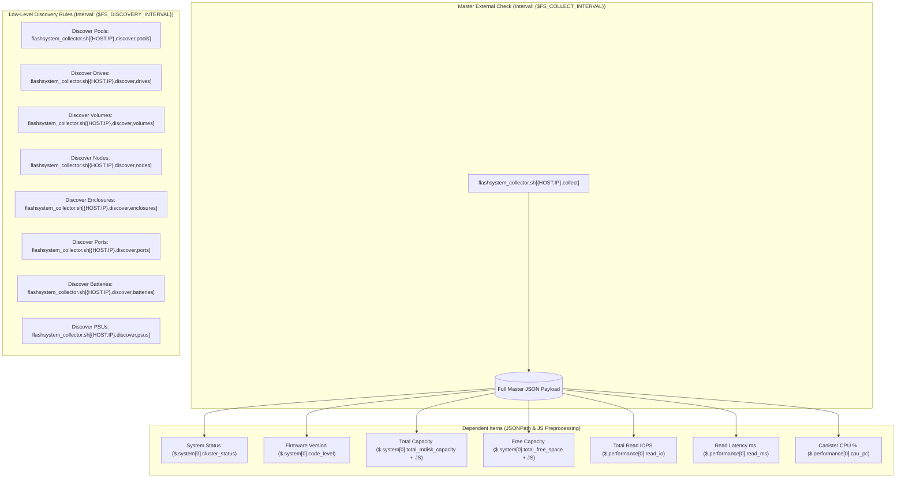

# Zabbix Integration 📊

This document details the configuration and operational architecture required to integrate `flashsystem-collector` with **Zabbix 6.4+** and **Zabbix 7.0 LTS / 7.2** using the official template (`template/IBM FlashSystem Collector.yaml`).

---

## 1. Integration Architecture (Master Item Pattern)

Rather than polling storage metrics through dozens of individual external scripts, the integration uses the **Master Item pattern**:



1. **Master Item**: A single External Check executes `flashsystem_collector.sh[{HOST.IP},collect]` once every polling interval (`{$FS_COLLECT_INTERVAL}`, default `1m`).
2. **Dependent Items**: Dozens of metrics extract values instantly from the Master Item payload in Zabbix server memory using JSONPath and JavaScript preprocessing, without triggering new SSH sessions or disk reads.
3. **Low-Level Discovery (LLD)**: Independent discovery rules run on longer intervals (`{$FS_DISCOVERY_INTERVAL}`, default `4h`) to create and manage dynamic prototypes.

---

## 2. Importing the Zabbix Template

The official template is located at:
`template/IBM FlashSystem Collector.yaml`

### Import Procedure
1. Log in to the Zabbix Web UI with Administrator privileges.
2. Navigate to **Data collection** > **Templates**.
3. In the upper-right corner, click **Import**.
4. Browse to and select `template/IBM FlashSystem Collector.yaml`.
5. Under **Rules**, ensure all options (**Update existing**, **Create new**) are checked.
6. Click **Import**.

---

## 3. Host Configuration & Linking

1. In Zabbix, navigate to **Data collection** > **Hosts** > **Create host**.
2. **Host name**: Specify your FlashSystem identifier (e.g., `FS9200-Cluster01`).
3. **Templates**: Select and link **`IBM FlashSystem Collector`**.
4. **Interfaces**: Add an **Agent** or **IPMI** interface with the **FlashSystem Management IP** (referenced by `{HOST.IP}`).
5. Navigate to the **Macros** tab to configure host-specific thresholds.

---

## 4. User Macros Reference

The template includes configurable user macros with production-tuned defaults:

| Macro | Default Value | Description |
| :--- | :--- | :--- |
| `{$FS_COLLECT_INTERVAL}` | `60` | Execution interval for the Master Item collector (in seconds; must be greater than `{$FS_TIMEOUT}`). |
| `{$FS_TIMEOUT}` | `55` | Timeout parameter for external script invocation (in seconds; requires `Timeout=60` or greater in `zabbix_server.conf`). |
| `{$FS_DISCOVERY_INTERVAL}`| `4h` | Execution interval for LLD rules (matches `FS_DISCOVERY_TTL`). |
| `{$FS_POOL_WARN_PCT}` | `80` | Warning threshold for storage pool capacity utilization (%). |
| `{$FS_POOL_CRIT_PCT}` | `90` | Disaster/critical threshold for storage pool capacity utilization (%). |
| `{$FS_LATENCY_READ_WARN}` | `2` | Read latency warning threshold in milliseconds (ms) (tuned for all-flash arrays per IBM Redbook SG248543; typically < 1ms). |
| `{$FS_LATENCY_READ_CRIT}` | `10` | Read latency critical threshold in milliseconds (ms). |
| `{$FS_LATENCY_WRITE_WARN}`| `5` | Write latency warning threshold in milliseconds (ms) (tuned for flash arrays). |
| `{$FS_LATENCY_WRITE_CRIT}`| `50` | Write latency critical threshold in milliseconds (ms) (per IBM Redbook SG248543 cap. 9; > 50ms indicates storage controller overload). |
| `{$FS_CPU_WARN}` | `80` | Canister CPU utilization warning threshold (%). |
| `{$FS_WRITE_CACHE_WARN}` | `70` | Write cache utilization warning threshold (%) (IBM Redbook SG248543 cap. 9 saturation metric). |
| `{$FS_WRITE_CACHE_CRIT}` | `85` | Write cache utilization critical threshold (%) (sustained > 85% indicates severe destage degradation risk). |
| `{$FS_TEMP_WARN}` | `35` | Ambient temperature warning threshold in Celsius (°C). |
| `{$FS_TEMP_CRIT}` | `40` | Ambient temperature critical threshold in Celsius (°C). |
| `{$FS_BATTERY_HEALTH_WARN}`| `70` | Enclosure battery charge/health warning threshold (%) (< 70% indicates significant degradation). |
| `{$FS_BATTERY_HEALTH_CRIT}`| `50` | Enclosure battery charge/health critical threshold (%) (replace battery immediately to prevent cache data loss). |

---

## 5. Capacity Metrics & JavaScript Preprocessing

IBM FlashSystem storage arrays can report capacities in two formats depending on the command executed:
1. Exact integer byte counts (when `-bytes` is passed to `lsmdiskgrp` and `lsvdisk`).
2. Human-readable strings with unit suffixes (e.g., `145.5TB`, `250.0GB`, `10.2MB`) when querying `lssystem`.

To handle both formats reliably, the template's JavaScript preprocessing accepts both raw numbers and suffixed strings:

```javascript
// Preprocessing logic implemented in Zabbix template:
var match = value.match(/^([0-9]+\.?[0-9]*)\s*(TB|GB|MB|KB|B)?$/i);
if (!match) return value;
var num = parseFloat(match[1]);
var unit = (match[2] || '').toUpperCase();
var mult = { 'TB': 1099511627776, 'GB': 1073741824, 'MB': 1048576, 'KB': 1024, 'B': 1 };
return Math.round(num * (mult[unit] || 1));
```

This guarantees that all capacity metrics in Zabbix (`flashsystem.system.capacity.total`, `flashsystem.system.capacity.free`, `flashsystem.pool.capacity`, `flashsystem.pool.free`) are stored as **exact integers in bytes**, allowing accurate charting, forecasting, and threshold evaluation.

---

## 6. Preconfigured Triggers and Alerts

The template includes preconfigured operational alerts:

- **Storage System Unreachable**: Fires if `flashsystem.collector.success[{HOST.IP}]` equals `0` for 3 consecutive polls (High severity).
- **ICMP Ping Unreachable**: Fires if `icmpping` equals `0` for 3 consecutive checks (High severity).
- **Cluster Status Not Online**: Fires if `flashsystem.system.status[{HOST.IP}]` is not `online` (Disaster severity).
- **Cluster Redundancy Degraded**: Fires if `flashsystem.system.nodes[{HOST.IP}]` drops below 2 active nodes (High severity).
- **Statistics Engine Disabled**: Fires if `flashsystem.system.statistics[{HOST.IP}]` is not `on` (Warning severity).
- **Pool Capacity Critical**: Fires if `flashsystem.pool.pct[{HOST.IP},{#POOLNAME}]` exceeds `{$FS_POOL_CRIT_PCT}` (High severity).
- **Pool Capacity Warning**: Fires if `flashsystem.pool.pct[{HOST.IP},{#POOLNAME}]` exceeds `{$FS_POOL_WARN_PCT}` and is below `{$FS_POOL_CRIT_PCT}` (Warning severity).
- **Read Latency (Warning / Critical)**: Fires if read latency exceeds `{$FS_LATENCY_READ_WARN}` (2ms, Warning) or `{$FS_LATENCY_READ_CRIT}` (10ms, High) sustained for 5 minutes.
- **Write Latency (Warning / Critical)**: Fires if write latency exceeds `{$FS_LATENCY_WRITE_WARN}` (5ms, Warning) or `{$FS_LATENCY_WRITE_CRIT}` (50ms, High) sustained for 5 minutes.
- **Write Cache Saturation (Warning / Critical)**: Fires if dirty write cache exceeds `{$FS_WRITE_CACHE_WARN}` (70%, Warning) or `{$FS_WRITE_CACHE_CRIT}` (85%, High) for 5 minutes.
- **High Storage Controller CPU**: Fires if canister CPU exceeds `{$FS_CPU_WARN}` (80%) for 5 minutes (Warning severity).
- **Ambient Temperature (Warning / Critical)**: Fires if ambient temperature exceeds `{$FS_TEMP_WARN}` (35°C, Warning) or `{$FS_TEMP_CRIT}` (40°C, High) for 5 minutes.
- **Battery Health Degraded / Critical**: Fires if battery charge drops below `{$FS_BATTERY_HEALTH_WARN}` (70%, Warning) or `{$FS_BATTERY_HEALTH_CRIT}` (50%, High) for 5 minutes.
- **Component Offline Failures**: Dynamic trigger prototypes fire when discovered storage pools, physical drives, virtual volumes, enclosures, nodes, FC ports, batteries, or PSUs leave their normal `online` / `active` state.

---

## 7. Troubleshooting Zabbix External Check Failures

If items show status **Unsupported** in Zabbix:

1. **Check Zabbix Server Timeout**: Ensure `/etc/zabbix/zabbix_server.conf` has `Timeout=30` or `Timeout=55`.
2. **Inspect Wrapper Logs**: Check `/var/log/zabbix/flashsystem_collector.log` for execution errors.
3. **Test as `zabbix` User**: Run the script manually to confirm permissions and key access:
   ```bash
   sudo -u zabbix /usr/lib/zabbix/externalscripts/flashsystem_collector.sh <HOST_IP> collect
   ```
4. **Verify SELinux**: On RHEL systems, verify SELinux isn't blocking external script execution:
   ```bash
   sudo ausearch -m avc -ts recent
   ```
