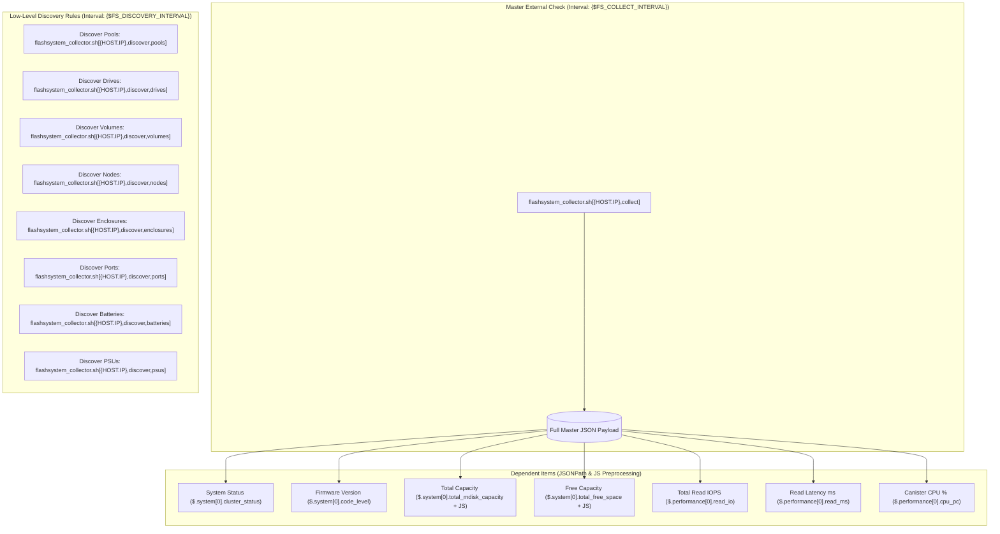

# Zabbix Integration 📊

This document details the configuration and operational architecture required to integrate `flashsystem-collector` with **Zabbix 6.4+** and **Zabbix 7.0 LTS / 7.2** using the official template (`template/IBM FlashSystem Collector.yaml`).

---

## 1. Integration Architecture (Master Item Pattern)

Rather than polling storage metrics through dozens of individual external scripts, the integration uses the **Master Item pattern**:



1. **Master Item**: A single External Check executes `flashsystem_collector.sh[{HOST.IP},collect]` once every polling interval (`{$FS_COLLECT_INTERVAL}`, default `1m`).
2. **Dependent Items**: Dozens of metrics extract values instantly from the Master Item payload in Zabbix server memory using JSONPath and JavaScript preprocessing, without triggering new SSH sessions or disk reads.
3. **Low-Level Discovery (LLD)**: Independent discovery rules run on longer intervals (`{$FS_DISCOVERY_INTERVAL}`, default `4h`) to create and manage dynamic prototypes.

---

## 2. Importing the Zabbix Template

The official template is located at:
`template/IBM FlashSystem Collector.yaml`

### Import Procedure
1. Log in to the Zabbix Web UI with Administrator privileges.
2. Navigate to **Data collection** > **Templates**.
3. In the upper-right corner, click **Import**.
4. Browse to and select `template/IBM FlashSystem Collector.yaml`.
5. Under **Rules**, ensure all options (**Update existing**, **Create new**) are checked.
6. Click **Import**.

---

## 3. Host Configuration & Linking

1. In Zabbix, navigate to **Data collection** > **Hosts** > **Create host**.
2. **Host name**: Specify your FlashSystem identifier (e.g., `FS9200-Cluster01`).
3. **Templates**: Select and link **`IBM FlashSystem Collector`**.
4. **Interfaces**: Add an **Agent** or **IPMI** interface with the **FlashSystem Management IP** (referenced by `{HOST.IP}`).
5. Navigate to the **Macros** tab to configure host-specific thresholds.

---

## 4. User Macros Reference

The template includes configurable user macros with production-tuned defaults:

| Macro | Default Value | Description |
| :--- | :--- | :--- |
| `{$FS_COLLECT_INTERVAL}` | `1m` | Execution interval for the Master Item collector. |
| `{$FS_DISCOVERY_INTERVAL}`| `4h` | Execution interval for LLD rules (matches `FS_DISCOVERY_TTL`). |
| `{$FS_TIMEOUT}` | `55s` | Timeout parameter for external script invocation. |
| `{$FS_POOL_WARN_PCT}` | `80` | Warning threshold for storage pool capacity utilization (%). |
| `{$FS_POOL_CRIT_PCT}` | `90` | Disaster/critical threshold for storage pool capacity utilization (%). |
| `{$FS_LATENCY_READ_WARN}` | `10` | Read latency warning threshold in milliseconds (ms). |
| `{$FS_LATENCY_WRITE_WARN}`| `10` | Write latency warning threshold in milliseconds (ms). |
| `{$FS_CPU_WARN}` | `80` | Canister CPU utilization warning threshold (%). |

---

## 5. Capacity Metrics & JavaScript Preprocessing

IBM FlashSystem storage arrays can report capacities in two formats depending on the command executed:
1. Exact integer byte counts (when `-bytes` is passed to `lsmdiskgrp` and `lsvdisk`).
2. Human-readable strings with unit suffixes (e.g., `145.5TB`, `250.0GB`, `10.2MB`) when querying `lssystem`.

To handle both formats reliably, the template's JavaScript preprocessing accepts both raw numbers and suffixed strings:

```javascript
// Preprocessing logic implemented in Zabbix template:
var match = value.match(/^([0-9]+\.?[0-9]*)\s*(TB|GB|MB|KB|B)?$/i);
if (!match) return value;
var num = parseFloat(match[1]);
var unit = (match[2] || '').toUpperCase();
var mult = { 'TB': 1099511627776, 'GB': 1073741824, 'MB': 1048576, 'KB': 1024, 'B': 1 };
return Math.round(num * (mult[unit] || 1));
```

This guarantees that all capacity metrics in Zabbix (`flashsystem.system.capacity.total`, `flashsystem.system.capacity.free`, `flashsystem.pool.capacity`, `flashsystem.pool.free`) are stored as **exact integers in bytes**, allowing accurate charting, forecasting, and threshold evaluation.

---

## 6. Preconfigured Triggers and Alerts

The template includes preconfigured operational alerts:

- **Storage System Unreachable**: Fires if `flashsystem.collector.success[{HOST.IP}]` equals `0` for 3 consecutive polls (Disaster severity).
- **Cluster Status Degraded**: Fires if `flashsystem.system.status[{HOST.IP}]` is not `online` (High severity).
- **Pool Capacity Critical**: Fires if `flashsystem.pool.pct[{HOST.IP},{#POOLNAME}]` exceeds `{$FS_POOL_CRIT_PCT}` (Disaster severity).
- **Pool Capacity Warning**: Fires if `flashsystem.pool.pct[{HOST.IP},{#POOLNAME}]` exceeds `{$FS_POOL_WARN_PCT}` (Warning severity).
- **High Read/Write Latency**: Fires if latency exceeds `{$FS_LATENCY_READ_WARN}` or `{$FS_LATENCY_WRITE_WARN}` for 5 minutes (Average severity).
- **High Storage Controller CPU**: Fires if canister CPU exceeds `{$FS_CPU_WARN}` for 5 minutes (Warning severity).
- **Component Failures**: Dynamic triggers for failed drives, degraded enclosure canisters, battery end-of-life warnings, and PSU power input/fan failures.

---

## 7. Troubleshooting Zabbix External Check Failures

If items show status **Unsupported** in Zabbix:

1. **Check Zabbix Server Timeout**: Ensure `/etc/zabbix/zabbix_server.conf` has `Timeout=30` or `Timeout=55`.
2. **Inspect Wrapper Logs**: Check `/var/log/zabbix/flashsystem_collector.log` for execution errors.
3. **Test as `zabbix` User**: Run the script manually to confirm permissions and key access:
   ```bash
   sudo -u zabbix /usr/lib/zabbix/externalscripts/flashsystem_collector.sh <HOST_IP> collect
   ```
4. **Verify SELinux**: On RHEL systems, verify SELinux isn't blocking external script execution:
   ```bash
   sudo ausearch -m avc -ts recent
   ```
